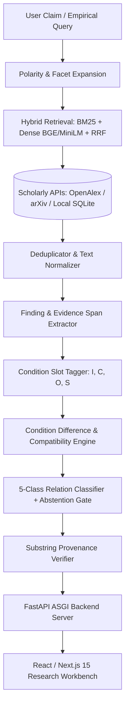

# Scientific Contradiction Finder

[](https://www.python.org/downloads/release/python-3110/)
[]()
[]()
[]()
[](https://opensource.org/licenses/MIT)

> **Condition-Aware Discovery and Analysis of Conflicting Scientific Findings**

Automated detection of conflicting empirical findings across scholarly literature. Unlike standard Natural Language Inference (NLI) that maps sentence pairs directly to entailment or contradiction without empirical context, **Scientific Contradiction Finder** explicitly parameterizes empirical conditions:
- **Intervention / Method ($I$)**
- **Comparator / Baseline ($C$)**
- **Outcome / Metric ($O$)**
- **Setting / Dataset / Population ($S$)**

When studies report diverging outcomes under differing conditions, they represent a *Qualified Disagreement* or *Incomparable Setting*, not a direct logical contradiction.

---

## Architecture Overview



---

## Research Workbench (React & Next.js)

The application features a production-grade research workbench built with **Next.js 15 (App Router)**, **React 19**, **TypeScript**, **Tailwind CSS**, and **Framer Motion**, engineered for empirical literature analysis:

- **Executive Research Deck**: Bottom-line scientific synthesis, subclaim decomposition matrix, and explicit confidence boundaries.
- **Evidence Ledger**: Verbatim source quotations with exact character offsets, study design indicators (RCT, Observational, Meta-Analysis), and multi-arm numerical attribution (sample sizes, point estimates, 95% CIs, p-values).
- **Study Comparison View**: Pairwise compatibility evaluations, condition difference summaries, and calibrated relationship classifications (`SUPPORTS`, `CONTRADICTS`, `QUALIFIES`, `INCOMPARABLE`, `INSUFFICIENT_EVIDENCE`).
- **Retrieval Diagnostics & Funnel**: Real-time provider status (OpenAlex, arXiv, Groq), literature screening metrics, and paper triage audit records.
- **CAS-Con150 Benchmark Explorer**: Live inspection and classification of the 150 benchmark finding pairs.
- **Design System**: Warm Charcoal + Muted Olive/Sage aesthetic, dark/light theme persistence, centralized CSS design tokens, responsive wide layout (`max-w-[1440px]`), and Framer Motion micro-interactions.

---

## 5-Class Relation Taxonomy

1. **`SUPPORTS_OR_CONSISTENT`**: Findings report concordant directional outcomes under matching or compatible conditions.
2. **`CONTRADICTS`**: Findings report conflicting directional outcomes under functionally identical conditions.
3. **`QUALIFIES_OR_PARTIAL_DISAGREEMENT`**: Findings diverge, but divergence is explained by differing comparator baselines, metrics, or sample settings.
4. **`INCOMPARABLE_CONDITIONS`**: Findings investigate fundamentally distinct interventions, outcomes, or tasks.
5. **`INSUFFICIENT_EVIDENCE`**: Passages lack empirical data, contain high extraction uncertainty, or fall below the decision confidence threshold.

---

## Empirical Evaluation & Benchmark Results

The primary evaluation of the system is conducted on the **Independent Primary Literature Benchmark** (`data/annotations/independent_eval_set.json`), featuring 35 distinct biomedical finding pairs (7 per class) curated directly from major medical journals (NEJM, Lancet, JAMA, BMJ, Nature Medicine) with verified DOIs/PMIDs and explicit adjudication criteria.

### Headline Benchmark Performance

| Evaluation Metric | Condition-Aware Pipeline | Unconditioned TF-IDF Baseline | Significance / Status |
| :--- | :---: | :---: | :--- |
| **Accuracy** | **88.57%** (31 / 35) | 37.14% (13 / 35) | **+51.43% improvement** |
| **Macro F1** | **0.8821** | 0.3024 | **+0.5797 improvement** |
| **Contradiction Precision** | **100.0%** (4 / 4) | 66.67% (4 / 6) | **Zero false-positive contradictions** |
| **Contradiction Recall** | **57.1%** (4 / 7) | 57.1% (4 / 7) | Conservative cohort/design gating |
| **Supports F1** | **1.0000** | 0.4242 | Perfect precision and recall |
| **Incomparable Conditions F1**| **0.9333** | 0.0000 | Baseline completely blind to disjoint tasks |
| **Insufficient Evidence F1**  | **1.0000** | 0.2500 | Reliable abstention on sparse evidence |

> [!WARNING] Sample Size & Generalization Caveat
> The independent benchmark contains **exactly 35 pairs (7 per class)**. These quantitative results represent **preliminary empirical evidence** supporting condition-aware reasoning over unconditioned text comparison, **NOT proof of universal generalization across scientific literature broadly**.

### Note on Synthetic CAS-Con150 Dataset
The project also maintains `CAS-Con150` (150 pairs). Evaluation audits revealed that CAS-Con150 was synthesized from **29 base claim templates**, creating data leakage under naive random splits. Under a corrected leakage-safe split ($N_{\text{test}}=46$), the TF-IDF baseline collapses to **19.57% (chance level)** while the condition-aware pipeline achieves **100.0%**. Historical scores citing 93.3% or 100% on CAS-Con150 reflect synthetic behavior and **must not be used as the headline measure of real-world performance**.

### Principal System Limitations
1. **Conservative Contradiction Recall (57.1%):** Safeguards against false contradictions prioritize 100% precision; opposing findings with cohort or comparator differences are cautiously qualified.
2. **Cautious Observational vs. RCT Gating:** The pipeline avoids conflating observational associations with causal RCT evidence; discordant cross-design findings are qualified rather than flagged as direct logical contradictions.
3. **Annotation Ambiguity:** In complex clinical contexts, human annotators may legitimately disagree on whether differences represent true contradictions or expected clinical effect modifications.
4. **Multi-Arm Extraction Constraints:** In trials with $\ge 3$ arms lacking explicit prepositions, the system safely abstains (`arm_name: None`) rather than risking numerical misattribution.
5. **Abstract-Only Literature Access:** When full-text PDFs are paywalled, the pipeline extracts from open-access abstracts, which may omit detailed subgroup definitions or secondary endpoints.

For full confusion matrices, genuine ablations, and error analyses, see [`docs/EVALUATION.md`](file:///Users/tanishporwal/Desktop/scientific_contradiction/docs/EVALUATION.md).

---

## Quickstart & Installation

### Using `uv` (Recommended)
```bash
# Clone the repository
git clone <repo-url>
cd scientific_contradiction

# Install dependencies and sync virtual environment
uv sync

# Configure environment
cp .env.example .env
```

### Using Standard `pip`
```bash
python3.11 -m venv .venv
source .venv/bin/activate
pip install -e ".[dev]"
python -m spacy download en_core_web_sm
cp .env.example .env
```

---

## Running the Application & Verification

### 1. Launch Next.js Research Workbench & FastAPI Backend
In two separate terminals:
```bash
# Terminal 1: FastAPI ASGI Backend (Port 8000)
uv run python scripts/run_server.py --port 8000

# Terminal 2: Next.js Frontend Workbench (Port 3000)
cd frontend
npm run dev
```
Open [http://localhost:3000](http://localhost:3000) to access the research workbench.

### 2. Streamlit Prototype (Alternative / Legacy)
For quick headless testing or reference, the earlier Streamlit prototype is also available:
```bash
uv run streamlit run src/scientific_contradiction_finder/ui/app.py
```

### 3. Run the Full Automated Test Suite (139 Tests)
```bash
uv run pytest
```

### 4. Run the Evaluation Pipeline
```bash
uv run python scripts/run_full_evaluation.py
```

### 5. Frontend & Backend Quality Checks
```bash
# Backend lint
uv run ruff check .

# Frontend typecheck & lint
cd frontend && npm run typecheck && npm run lint && npm run build
```

---

## Zero-Cost & Offline-First Principles

This system operates with **$0 external API spend**. It uses local transformer and classical NLP models (`scikit-learn`, `rank-bm25`, `all-MiniLM-L6-v2`) and interfaces with open scholarly APIs (OpenAlex and arXiv) backed by persistent SQLite caching and offline fallback capabilities.
