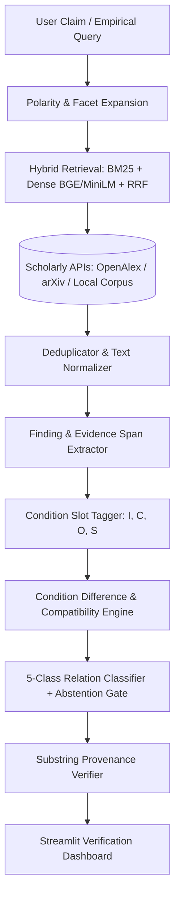

# Scientific Contradiction Finder

[](https://www.python.org/downloads/release/python-3110/)
[](https://opensource.org/licenses/MIT)

> **Condition-Aware Discovery and Analysis of Conflicting Scientific Findings**

Automated detection of conflicting empirical findings across scholarly literature. Unlike standard Natural Language Inference (NLI) that maps sentence pairs directly to entailment or contradiction without empirical context, **Scientific Contradiction Finder** explicitly parameters empirical conditions:
- **Intervention / Method ($I$)**
- **Comparator / Baseline ($C$)**
- **Outcome / Metric ($O$)**
- **Setting / Dataset / Population ($S$)**

When studies report diverging outcomes under different conditions, they represent a *Qualified Disagreement* or *Incomparable Setting*, not a direct logical contradiction.

---

## Architecture Overview



---

## 5-Class Relation Taxonomy

1. **`SUPPORTS_OR_CONSISTENT`**: Findings report concordant directional outcomes under matching or compatible conditions.
2. **`CONTRADICTS`**: Findings report conflicting directional outcomes under functionally identical conditions.
3. **`QUALIFIES_OR_PARTIAL_DISAGREEMENT`**: Findings diverge, but divergence is explained by differing comparator baselines, metrics, or sample settings.
4. **`INCOMPARABLE_CONDITIONS`**: Findings investigate fundamentally distinct interventions, outcomes, or tasks.
5. **`INSUFFICIENT_EVIDENCE`**: Passages lack empirical data, contain high extraction uncertainty, or fall below the decision confidence threshold.

---

## Quickstart & Installation

```bash
# Clone the repository
git clone <repo-url>
cd scientific_contradiction

# Create and activate Python 3.11 virtual environment
python3.11 -m venv .venv
source .venv/bin/activate

# Install package and dependencies
pip install -e ".[dev]"
python -m spacy download en_core_web_sm

# Configure environment
cp .env.example .env
```

---

## Running the Application

### 1. Launch the Streamlit Dashboard
```bash
streamlit run src/scientific_contradiction_finder/ui/app.py
```

### 2. Run Test Suite
```bash
pytest -v tests/
```

### 3. Run Benchmark Evaluation
```bash
python scripts/evaluate_pipeline.py --dataset cas_con150
```

---

## Zero-Cost & Offline-First Principles
This system requires **$0 external API spend**. It uses local transformer and classical NLP models (`scikit-learn`, `rank-bm25`, `all-MiniLM-L6-v2`) and interfaces with open scholarly APIs (OpenAlex and arXiv) with local SQLite caching.
